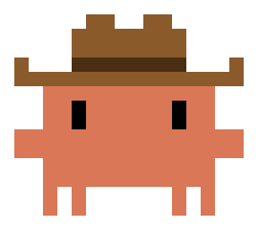

<p align="center"></p>

# claude-cowboy

A [Claude Code](https://claude.com/claude-code) skill for multi-agent orchestration — a Claude Code port of pi-cowboy.

Split a large job into focused subtasks and delegate them to background coding agents (Claude Code, Codex, pi, OpenCode). Each agent runs in its own Herdr workspace, isolated in a copy-on-write Git worktree on its own branch. The orchestrator then steers and reviews them, and lands the work (as a PR or a local merge) when you say so.

See [`SKILL.md`](SKILL.md) for full usage.

## Requirements

- Claude Code
- Herdr (the skill must run inside a Herdr pane, `HERDR_ENV=1`)
- Git, Python 3
- Optional harnesses: `codex`, `pi`, `opencode`

## Install

```bash
git clone https://github.com/nicklausroach/claude-cowboy ~/.claude/skills/claude-cowboy
```

The skill calls its helper by the literal path `~/.claude/skills/claude-cowboy/scripts/cowboy`, so install it at exactly that location. You may want to add a permission allow-rule for that path, e.g. in `~/.claude/settings.json`:

```json
{ "permissions": { "allow": ["Bash(~/.claude/skills/claude-cowboy/scripts/cowboy:*)"] } }
```

## Usage

Start Claude Code inside a Herdr pane, in a Git repo, and hand it a job:

```
/claude-cowboy add input validation to every API handler, and write tests for each
```

Claude acts as the orchestrator. It breaks the job into focused subtasks and spawns one background agent for each. Every agent gets its own branch (`cow-<slug>-<id>`), its own copy-on-write worktree and its own Herdr workspace. When agents finish, Claude reads their reports, reviews the diffs and reports back. Nothing is merged, pushed or cleaned up until you say so. You can open any agent's Herdr workspace to watch it or step in.

### Slash command shortcuts

| Command | What it does |
| --- | --- |
| `/claude-cowboy` | Show agent status and suggest next steps |
| `/claude-cowboy status` (`st`) | List agents: queued, running, blocked, settled, stopped, exited |
| `/claude-cowboy spawn <task>` (`sp`) | Spawn one agent for a single task |
| `/claude-cowboy worktree <name>` (`wt`) | Create a cowboy worktree with no agent |
| `/claude-cowboy model <alias>` | Set the default agent model (`haiku`, `sonnet`, `opus`, `fable` or a full ID; `clear` resets it) |
| `/claude-cowboy templates` | List agent and orchestrator templates |
| `/claude-cowboy config` | Show the current config |
| `/claude-cowboy diff <id>` | Show an agent's commits and uncommitted changes |
| `/claude-cowboy <anything else>` | Treat it as a job to break down and delegate |

You can also just ask in plain language, e.g. "spin up cowboy agents to migrate these three services in parallel".

### Agent lifecycle

1. **Spawn.** Claude writes a self-contained prompt for each subtask. By default up to 4 agents run at once and the rest wait in a queue.
2. **Wait.** A background waiter per agent tells Claude when the agent settles, so nothing polls.
3. **Review / steer.** Claude checks each diff. If work needs another pass, Claude *steers* the agent with follow-up instructions in its existing pane.
4. **Blocked agents.** If an agent needs a decision (or is stuck at a dialog), Claude passes the question to you and won't approve anything on your behalf unless you've said it can.
5. **Report.** Claude summarizes the work and stops. The worktree, branch and Herdr workspace stay open so you can inspect it or ask for changes.
6. **Land (on your say-so).** Either push the branch and open a pull request straight from the agent's worktree (the worktree stays open for review follow-ups), or merge it into your main checkout. A local merge needs the checkout on the target branch and clean; a conflict stops the merge and leaves it for you to resolve.
7. **Clean up (on your say-so).** Closes the agent's workspace, removes the worktree and deletes the branch if it's merged. Anything that would throw away work (uncommitted changes, unmerged branches) needs your explicit OK.

### Picking a harness, model or role

Ask for a different setup when you describe the job ("use codex for the frontend task", "run the search with haiku"), or set defaults:

```bash
~/.claude/skills/claude-cowboy/scripts/cowboy config --set agent.harness=codex
~/.claude/skills/claude-cowboy/scripts/cowboy config --set agent.model=sonnet
~/.claude/skills/claude-cowboy/scripts/cowboy config --set concurrency.default=6
~/.claude/skills/claude-cowboy/scripts/cowboy config --set concurrency.models.opus=1
```

Models are chosen in this order: the per-spawn `-m` flag, then the template's per-harness model, then the template's model, then `agent.model`, then the harness's own default.

### Templates

- **Agent templates** are reusable roles. `general-purpose` (the default) and `Explore` (read-only search) are bundled. Add your own as `~/.claude/claude-cowboy/agents/<name>.toml` with a system prompt, an optional model, effort or harness, and per-harness tool allow/deny lists. See `agents/` for examples.
- **Orchestrator templates** add guidance for every agent. `review-before-commit` is bundled. Turn one on with `cowboy config --set orchestrator=review-before-commit` (set it to `null` to turn it off).

### Tips

- Jobs that split into independent pieces touching separate files work best, because merges stay clean.
- Treat an agent's report as its own claim and check the diff, which Claude does before merging.
- Run `cowboy status --all` to see agents that have already been cleaned up.

See [`SKILL.md`](SKILL.md) for the full reference, including every config key.

## Notes

- Spawned agents run with permission checks **bypassed by default** (`agent.permission_mode = bypass`, matching pi-cowboy). Change it with `cowboy config --set agent.permission_mode=<mode>`.
- State lives in `$CLAUDE_COWBOY_HOME` (default `~/.claude/claude-cowboy`).
- Agent templates live in `agents/`, orchestrator templates in `orchestrators/`.
- To coordinate agents on several machines from one session, see [claude-space-cowboy](https://github.com/nicklausroach/claude-space-cowboy). It runs this helper on each machine over SSH, with these environment variables:
  - `CLAUDE_COWBOY_COORDINATED=1`: allow commands outside a Herdr pane, as long as a Herdr server is running on the machine.
  - `CLAUDE_COWBOY_HERDR_SESSION=<name>`: the Herdr session to use (default: `default`).
  - `HERDR_BIN=<path>`: the herdr binary, if it is not on `PATH` (`~/.local/bin/herdr` is also tried).

## Tests

The tests use only the standard library and mock Herdr, so they don't need a Herdr server. Run them from the repo root:

```bash
python3 -m unittest discover tests -v
```
